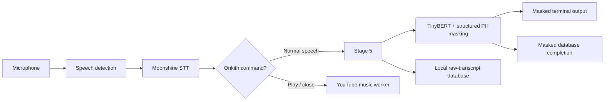

# Omit AI

Omit AI is a local speech-transcription and privacy-masking pipeline for
Raspberry Pi 5 and Windows. It records short utterances, transcribes them with
Moonshine, replaces detected PII with placeholders, and shows only the masked
transcript in the normal terminal.

```text
  You      Please call [GIVENNAME_1] at [TELEPHONENUM_1]

  Onkith   Opening Dancing with Monsters
```

> **Research notice:** This is not a medical device and must not be used for
> diagnosis or treatment. Clinical use requires independent validation,
> privacy review, and an approved data-retention policy.

## Pipeline



In plain language:

1. The microphone records one bounded utterance.
2. Moonshine converts the audio to text locally.
3. Onkith commands are separated from ordinary speech.
4. Ordinary speech enters immediate Stage 5.
5. TinyBERT and structured recognizers detect PII.
6. The terminal displays the masked result; SQLite stores the local record.

The microphone, STT, privacy, music, and database stages use separate workers,
so slow model or database work does not run inside the audio callback.

## Privacy behavior

| Item | Behavior |
|---|---|
| Audio | Processed in memory; debug audio saving is disabled |
| Normal terminal | Shows only the final masked transcript |
| Masking failure | Fails closed: `[BLOCKED: PII MASKING FAILED]` |
| SQLite | Stores raw and masked transcripts locally |
| Internet | Used only for optional Onkith YouTube search/playback |

The database files contain sensitive raw text and must never be uploaded:

```text
session_transcript.db
session_transcript.db-wal
session_transcript.db-shm
```

## Models

- **STT:** Moonshine English Medium Streaming
- **Privacy:** TinyBERT-4 INT8 ONNX plus structured PII recognizers
- **Output:** numbered placeholders such as `[GIVENNAME_1]` and `[EMAIL_1]`
- **Target:** Raspberry Pi 5, 4 GB RAM, 64-bit OS, Python 3.11

## Benchmark

| Test condition | Samples | WER | Decode RTF |
|---|---:|---:|---:|
| Final `test-clean` | 300 | 8.73% | 0.722 |
| Paired clean | 120 | 10.05% | 0.645 |
| Mild room condition | 120 | 10.43% | 0.611 |
| Realistic room condition | 120 | 15.05% | 0.597 |
| Hard room condition | 120 | 32.83% | 0.603 |
| **Direct-local true-live microphone** | **100** | **12.10%** | **0.850** |

- **WER:** word transcription error rate; lower is better.
- **Decode RTF:** STT decoding time divided by audio duration. Below `1.0`
  means faster than real time.
- An RTF of `0.850` is approximately 8.5 seconds of decoding per 10 seconds of
  submitted audio.

Decode RTF does not include recording silence, privacy masking, database work,
YouTube requests, or browser startup. Benchmark datasets and scripts are not
included in this deployment repository.

## Raspberry Pi setup

```bash
unzip Omit_AI_RPi_Live.zip
cd Omit_AI_RPi_Live
chmod +x install_pi.sh run_live.sh check_pi.sh
./install_pi.sh
./run_live.sh --list-devices
./run_live.sh --device 1
```

Replace `1` with the detected microphone ID.

## Windows setup

```powershell
conda create -n omit-live python=3.11 -y
conda activate omit-live
python -m pip install -r .\requirements-rpi.txt
python -m app.omit_ai_live --list-devices
python -m app.omit_ai_live --device 1
```

Run these commands from the project root. Press `Ctrl+C` once for a safe,
drain-first shutdown.

## Onkith YouTube commands

Create a local `.env` file:

```text
YOUTUBE_API_KEY=your_key_here
YOUTUBE_REGION=SA
```

Example commands:

```text
Onkith play Adele easy on me
Onkith open Imagine Dragons Bones
Onkith stop the music
```

Only the selected music query is sent to YouTube. The player uses a dedicated
browser process and CLOSE targets only that owned player.

Never commit `.env`. If a key has appeared in a public repository, screenshot,
terminal log, or chat, revoke it and create a replacement.

## Recording defaults

| Setting | Value |
|---|---:|
| Room calibration | 2.0 seconds |
| Pre-roll | 0.4 seconds |
| End silence | 2.5 seconds |
| Maximum utterance | 8.5 seconds |
| Continuous-speech overlap | 0.35 seconds |

## Verification

```bash
.venv/bin/python -m unittest discover -s tests -v
./run_live.sh --self-test
./check_pi.sh
```

## Before uploading to GitHub

1. Rotate any previously exposed API key.
2. Confirm `.env` and `session_transcript.db*` are not staged.
3. Check for credentials with `git grep -n "AIza"`.
4. Review the diff for transcripts, identifiers, screenshots, and local paths.

The included `.gitignore` excludes the API file, transcript database, player
page, and Python cache files.

## Limitations

- English-only STT model
- PII detection may produce false positives or false negatives
- Raw transcripts are retained in local SQLite storage
- Physical-microphone performance depends on room noise and hardware
- YouTube requires network access, API quota, and a supported browser
