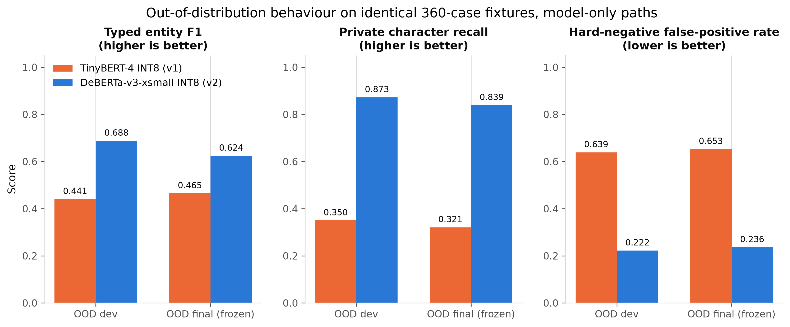
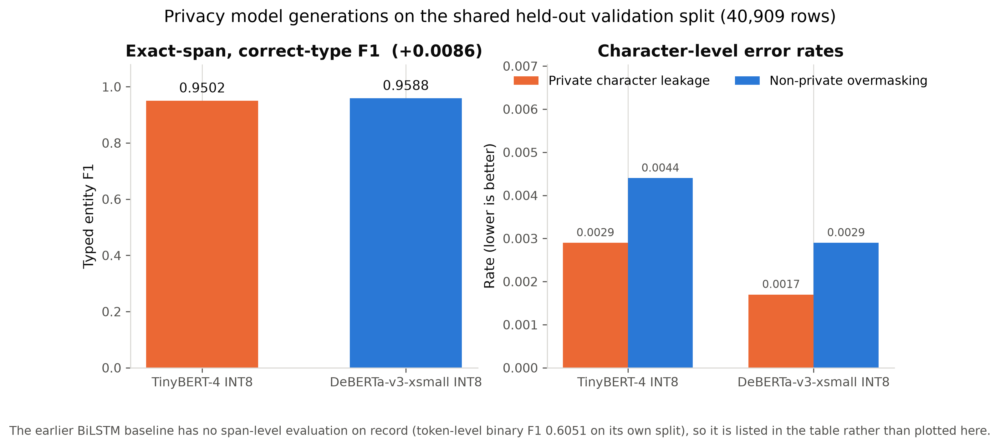
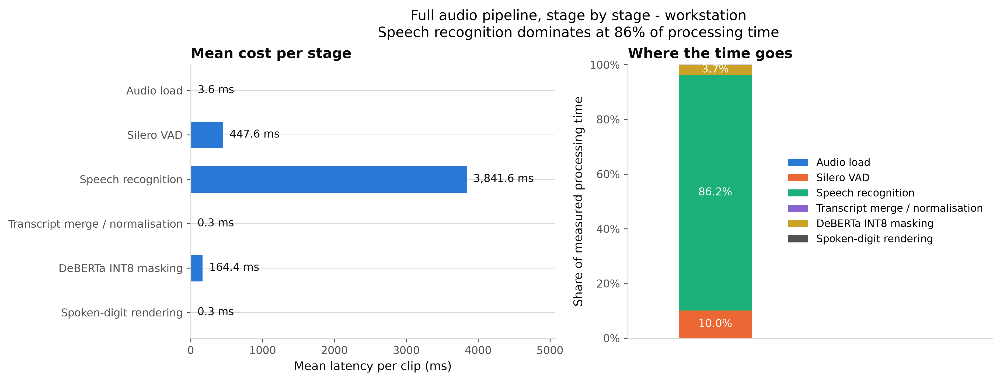
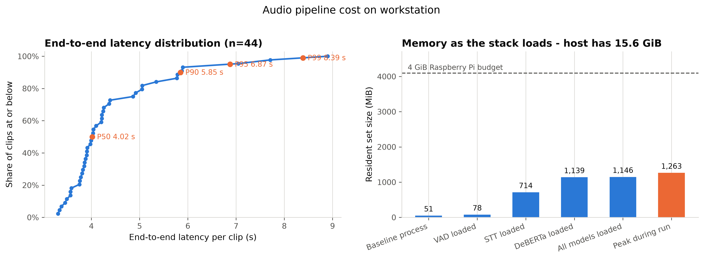

<p align="center">
  
</p>

<h1 align="center">OnKith</h1>

<p align="center">
  <strong>Privacy-preserving local voice processing for edge AI systems.</strong><br>
  <em>What happens at home, stays at home.</em>
</p>

<p align="center">
  <a href="https://onkith.online/">Website</a>
  &nbsp;·&nbsp;
  <a href="#how-onkith-evolved">How it evolved</a>
  &nbsp;·&nbsp;
  <a href="#raspberry-pi-5-deployment">Raspberry Pi results</a>
  &nbsp;·&nbsp;
  <a href="#reproducing-the-benchmarks">Reproduce</a>
  &nbsp;·&nbsp;
  <a href="#known-limitations">Limitations</a>
</p>

---

> **In progress: V4 has replaced the speech recognizer, and this README has not
> caught up yet.**
>
> The active pipeline is now [`FullPipeline_V4/`](FullPipeline_V4/): V3's
> architecture with **faster-whisper `base.en`** (CTranslate2, CPU, INT8, beam 5)
> in place of NVIDIA Canary 180M Flash. Everything downstream of the recognizer -
> VAD, segmentation, transcript merging, DeBERTa-v3-xsmall INT8 masking, span
> merging, spoken-digit rendering, storage, UI - is V3's code, unchanged, and a
> regression test asserts that identical text produces identical masked output on
> both.
>
> The Canary pipeline is preserved verbatim at
> [`archive/FullPipeline_V3/`](archive/FullPipeline_V3/). Its measurements in
> [`research_results/`](research_results/) are a frozen baseline and are never
> regenerated. Links to `FullPipeline_V3/` below therefore point at the archive.
>
> **Every performance and accuracy number below the fold is still Canary's.**
> The Whisper workstation run is done; the Whisper Raspberry Pi run is not. This
> file, the pipeline READMEs and the results discussion are rewritten in one pass
> once that run lands, so the numbers change once rather than twice.


OnKith is a voice pipeline that runs entirely on a small edge device. It listens,
transcribes speech locally, removes personally identifiable information from the
transcript, and only then lets the text go anywhere else. No audio and no raw
transcript ever leaves the device.

The whole system — speech recognition, privacy detection, masking — has been
measured end to end on a **4 GB Raspberry Pi 5**. The results, including the
uncomfortable ones, are below.

## The problem

Voice assistants are useful because they understand natural speech. They are
uncomfortable because understanding natural speech has usually meant streaming
your living room to someone else's servers.

The usual privacy controls are all-or-nothing. You either send the whole
utterance to the cloud, or you send nothing and lose the capability. But most
sentences are not uniformly sensitive:

```text
"Remind me to call Dr. Sarah Chen at 555-0147 about my appointment on Tuesday."
```

The useful intent — *set a reminder about an appointment on Tuesday* — carries
almost no privacy risk. The name and the phone number carry nearly all of it.
Discarding the sentence throws away the intent; forwarding it exposes the
identifiers.

OnKith separates the two. Sensitive spans are detected and replaced locally, and
only the redacted remainder is available to anything downstream:

```text
"Remind me to call [TITLE_1] [GIVENNAME_1] [SURNAME_1] at [TELEPHONENUM_1]
 about my appointment on [DATE_1]."
```

## Why local processing matters

Redaction is only a privacy guarantee if it happens *before* the data leaves your
control. A cloud service that promises to delete identifiers has already received
them. OnKith performs speech recognition and PII removal on the device, so:

- raw audio is never transmitted, stored, or written to disk;
- the unredacted transcript exists only in memory, only briefly;
- the pipeline keeps working with no network connection;
- if masking fails for any reason, the text is **blocked rather than released**.

That last point is the design rule the rest of the system is built around: the
pipeline fails closed. A masking error never degrades into passing the original
text through.

---

## System architecture

```text
microphone (16 kHz mono)
   │
   ▼
Silero VAD + energy gate          400 ms pre-roll, endpoint detection,
   │                              overlap-based segmentation of long speech
   ▼
NVIDIA Canary 180M Flash          on-device speech-to-text, CPU, beam size 2
   │
   ▼
transcript merge + normalisation  14-word overlap merge, wake-word handling,
   │                              3.0 s inactivity buffer
   ▼
DeBERTa-v3-xsmall INT8            31 entity types / 63 BIO labels,
   │                              ONNX Runtime, 512-token window, 128 stride
   ▼
structured recognizers            regex layer for explicitly cued emails,
   │                              phone, account and identifier numbers
   ▼
whole-word span merge             deterministic overlap resolution
   │
   ▼
masked text  ──▶  local SQLite  ──▶  terminal / downstream use
```

Everything above the last line runs on the device. The production package is
[`FullPipeline_V3/`](FullPipeline_V3/).

Three details make the masked output trustworthy rather than merely plausible:

- **Whole-word consolidation.** Transformer models see subwords. Masking at the
  subword level produces leaks like `[EMAIL]@example[EMAIL]`, where the domain
  survives. OnKith promotes subword evidence to complete words before masking.
- **Sliding windows.** Text longer than the 512-token context is re-encoded as
  overlapping windows with 128-token stride, and every token is scored. Long
  input is never silently truncated.
- **Fail-closed release.** `safe_to_release` gates the output. A masking error
  blocks the utterance instead of publishing it.

---

## How OnKith evolved

OnKith did not start as the system above. Three tracks changed independently, and
each change was driven by a measurement that exposed a problem.

### 1. The privacy model

```text
binary sentence classifier → BiLSTM span baseline → TinyBERT-4 → DeBERTa-v3-xsmall → ONNX → INT8 → Pi
```

| Stage | What it was | Why it changed |
|---|---|---|
| Binary classifier | An LSTM that labelled a whole sentence private or not. | Too coarse. OnKith has to remove *the sensitive part* and keep the rest, which a sentence-level label cannot express. Replaced by span-level PII detection ([`model/baseline_model/`](model/baseline_model/)). |
| BiLSTM baseline | First span model. Token-level binary F1 **0.6051** on its own split. | Established the task and the harness. Not competitive, and not span-comparable to what followed. |
| TinyBERT-4 INT8 | 4-layer transformer, 67 BIO labels, 13.7 MiB INT8 ONNX. Deployed in the pipelines now under `archive/`. | Strong in-distribution (typed entity F1 **0.9502** on held-out validation) but the first out-of-distribution fixtures showed it collapsing — see below. |
| DeBERTa-v3-xsmall INT8 | Model V2: 31 entity types / 63 BIO labels, 78.5 MiB INT8 ONNX. Current production. | Chosen for out-of-distribution robustness, not headline F1. |

The evidence is in
[`model/privacy_evaluation/OOD_BASELINE_FINDINGS.md`](model/privacy_evaluation/OOD_BASELINE_FINDINGS.md),
which landed in the same commit as the first DeBERTa backbone preflight — the
measurement and the search for a replacement were one piece of work. On two
independently generated 360-case fixtures, TinyBERT scored typed entity F1
0.44–0.46 with private-character recall of **0.32–0.35**, and false-positive
rates on hard negatives near 0.65. Its stated conclusion shaped everything after
it:

> Strong IID scores do not predict robust OOD privacy behavior.

<p align="center">
  
</p>

### 2. The data

The dataset strategy changed more than the architecture did, and for the same
reason: evaluation kept exposing weaknesses.

| Stage | What changed | Why |
|---|---|---|
| Sentence labels | Binary private/non-private text. | Wrong shape for masking. |
| PII masking corpora | Moved to [AI4Privacy](https://huggingface.co/datasets/ai4privacy) with full BIO token labelling. `pii-masking-300k` for Model V1, then the larger `pii-masking-openpii-1.5m` (pinned revision) as the Model V2 base. | Span-level supervision at real scale. |
| Ontology rebuild | 33 entities / 67 labels → **31 entities / 63 labels**. `ALLERGIES` (3 spans), `USERNAME` (16 spans) and `WEIGHT` (1 span) removed; `PASSWORD` added. | Labels with a handful of spans are not coverage. `PASSWORD` protects a *disclosed secret* under explicit admission rules, and the rejected cases ("I forgot my password") became hard negatives. |
| Supplementary sources | Gretel `gretel-pii-masking-en-v1`, DataikuNLP `kiji-pii-training-data`, NVIDIA `Nemotron-PII` (optional), plus a project-generated Saudi/MENA corpus. | Targeted gap-filling for empty and OOD-weak labels, not bulk volume. |
| Saudi / local coverage | A generated Saudi/MENA supplementary corpus built from public official sources — Saudi Central Bank licensed-institution names, government and university nomenclature, Wikidata city labels, an open traffic-intersection export, and a CC0 Arabic/Muslim given-name vocabulary. Saudi IBANs use the correct SAMA format and VAT numbers the 15-digit ZATCA format. | Upstream corpora are overwhelmingly Western. Saudi identifier formats, city and organisation names were simply absent. It is a deliberately small, curated addition (450 rows) rather than bulk synthetic volume. |
| Leakage-aware splitting | Supplementary data split 80/20 by connected components over four enforced factors: entity value, e-mail domain, template, organisation family. Three further factors are measured but deliberately not enforced. | A random split over generated data validates memorisation. Grouped splitting is what makes `val_supplementary` mean something. |
| Contamination firewall | A deterministic sweep removes training-side rows that are byte-identical to a protected evaluation row. Protected sets are never modified. | AI4Privacy ships zero-length `source_text` rows in *both* its official train and validation splits, so eight pinned training rows collided with `val_original`. |
| Frozen OOD final | A 360-case fixture in a separate notebook that refuses to run twice. | A benchmark inside a development notebook eventually gets run by accident, and then it is a selection metric rather than a test. |

Full methodology: [`model/privacy_data_v2/README.md`](model/privacy_data_v2/README.md).

The assembled corpus is published as
[`KhalidAlharbi377/pii-detection-multisource-en-saudi-arabic`](https://huggingface.co/datasets/KhalidAlharbi377/pii-detection-multisource-en-saudi-arabic)
(CC BY 4.0): 284,619 English rows, 2,088,335 labelled spans, 31 entity types, in
the same four splits this repository's data manifest records — 217,667 train,
40,909 original validation, 6,907 supplementary validation, 19,136 test. Its
composition is 85.0% AI4Privacy OpenPII, 8.3% NVIDIA Nemotron-PII, 3.6% Gretel,
2.2% Kiji, plus the OnKith-generated password disclosures (2,145 rows), Saudi/MENA
rows (450) and hard negatives (146).

That history is why OnKith reports six evaluation views instead of one number.
Each exists because a single score was once misleading:

| View | Rows | What it answers |
|---|---:|---|
| `test` | 19,136 | Held-out, same distribution as training. |
| `val_original` | 40,909 | The untouched AI4Privacy English validation split — the one metric comparable across model generations. |
| `val_supplementary` | 6,907 | Grouped 20% holdout of the supplementary pool. Harder, and honest about it. |
| `combined_validation` | 47,816 | Both validation sets together. |
| `ood_dev` | 360 | Speech-shaped, adversarial, independently generated. May guide error analysis. |
| `ood_final` | 360 | Same design, frozen, scored **once**. |

Two deployment benchmarks sit on top of those: a 2,000-row CPU/text subset that
verifies the *deployed artifact* behaves identically on two devices, and a
44-clip audio benchmark that measures the whole system from sound.

### 3. Speech-to-text

The recognizer changed repeatedly during real microphone testing, and the
repository records the configurations rather than a written head-to-head, so this
part is reported briefly and factually.

| Stage | Model | What the repository records |
|---|---|---|
| First Pi experiment | Moonshine | Audio captured manually so RNNoise denoising could be inserted ahead of the recognizer, using Moonshine's integrated VAD/segmenter ([`archive/moonshine_pi_project/`](archive/moonshine_pi_project/)). |
| Tuned STT harness | Moonshine v2 Medium Streaming | RNNoise ended up **off**; VAD threshold, pre-roll and endpoint silence tuned by hand. Word error rate recorded across six conditions: **8.73%** on `test-clean`, **12.10%** on direct live-microphone input, and 32.83% in a hard room ([`archive/moonshine-pi-v2/`](archive/moonshine-pi-v2/)). The harness targeted the Pi, but the table does not state which device each row was measured on. |
| Integrated pipelines V1/V2 | Moonshine v2 Medium Streaming | Speech recognition and TinyBERT masking in one process. |
| Production | **NVIDIA Canary 180M Flash** | Silero VAD replaces Moonshine's integrated segmentation; overlap segmentation plus a 14-word merger handles long speech. Committed reference: **4.90%** WER on LibriSpeech. |

So: several recognizers were run against a real microphone before the project
converged on Canary. What is *measured in this repository* is that Moonshine's
live-microphone word error rate was around 12% while Canary's committed
LibriSpeech reference is 4.90%; those two numbers come from different scripts and
are not a controlled comparison, and the repository contains no written record of
the moment the decision was taken. A separate branch (`turki/onkith-terminal`)
also evaluated Whisper `base.en` on the Pi for a voice-terminal variant; it is
not part of this pipeline.

The Raspberry Pi benchmark later showed that the recognizer, not the privacy
model, is what limits the system — which is only interesting because the
recognizer had already been treated as the replaceable component.

---

## Final privacy model

**DeBERTa-v3-xsmall, 31 entity types / 63 BIO labels, INT8 ONNX, 78.47 MiB.**
SHA-256 `bc8d1d7a7fb14304e195e47079c3dbb330c627ea4c9753f3af667676048106a8`,
verified by every benchmark before it reports a privacy number.

| View | Rows | Typed entity F1 | Private character recall | Leakage |
|---|---:|---:|---:|---:|
| `test` | 19,136 | 0.9527 | 0.9973 | 0.0027 |
| `val_original` | 40,909 | **0.9588** | 0.9983 | 0.0017 |
| `val_supplementary` | 6,907 | 0.8849 | 0.9843 | 0.0157 |
| `combined_validation` | 47,816 | 0.9534 | 0.9969 | 0.0031 |
| `ood_dev` | 360 | 0.6882 | 0.8725 | 0.1275 |
| `ood_final` *(frozen, spent once)* | 360 | **0.6244** | 0.8390 | 0.1610 |

The top four rows are in-distribution. The bottom two are not, and the gap is
real: OOD typed F1 is about a third lower than IID. That gap is reported here
rather than buried because it is the honest description of how the model behaves
on speech it was never trained on.

Quantization cost at most **0.0182** typed F1 (on `ood_dev`) against a release
gate of 0.02, and every view passed. On `ood_dev`, INT8 actually *improved*
character recall over FP32.

### Model V1 → Model V2

Same held-out AI4Privacy English validation split, same metric definitions, both
decoded through the production span-decoding rule:

| Metric | TinyBERT-4 INT8 (V1) | **DeBERTa-v3-xsmall INT8 (V2)** |
|---|---:|---:|
| Typed entity F1 | 0.9502 | **0.9588** |
| Private character leakage | 0.0029 | **0.0017** |
| Non-private overmasking | 0.0044 | **0.0029** |

<p align="center">
  
</p>

In-distribution the improvement is modest. Out of distribution — the same 360-case
fixtures, model-only in both cases — it is the whole point:

| Fixture | Metric | TinyBERT-4 INT8 | **DeBERTa INT8** |
|---|---|---:|---:|
| OOD dev | Typed entity F1 | 0.4406 | **0.6882** |
| OOD dev | Private character recall | 0.3500 | **0.8725** |
| OOD dev | Hard-negative FP rate | 0.6389 | **0.2222** |
| OOD final *(frozen)* | Typed entity F1 | 0.4649 | **0.6244** |
| OOD final *(frozen)* | Private character recall | 0.3209 | **0.8390** |
| OOD final *(frozen)* | Hard-negative FP rate | 0.6528 | **0.2361** |

Character recall going from 0.32 to 0.84 on the frozen set is the result that
justified the migration: under distribution shift, Model V1 was letting roughly
two thirds of private characters through.

---

## Raspberry Pi 5 deployment

**Hardware:** Raspberry Pi 5 Model B Rev 1.0, 4 GB class (3.95 GiB visible),
64-bit Raspberry Pi OS, Linux aarch64, 4 cores, Python 3.11.9, ONNX Runtime
1.29.0.

### Privacy model, device against device

Both devices scored the identical committed 2,000-row subset through the
identical hash-verified INT8 artifact.

| Metric | Workstation (x86-64, 20 threads) | **Raspberry Pi 5 (4 GB)** |
|---|---:|---:|
| Typed entity F1 | 0.9452 | **0.9448** |
| Private character recall | 0.9950 | **0.9949** |
| Private character leakage | 0.0050 | **0.0051** |
| Mean masking latency | 84.0 ms | **83.6 ms** |
| P50 / P95 / P99 | 46.5 / 290.4 / 722.4 ms | **53.2 / 226.2 / 442.2 ms** |
| Throughput | 11.89 rows/s | **11.95 rows/s** |
| Peak process RSS | 1,741 MiB | **2,393 MiB** |

Prediction agreement between the two devices is **98.35%** (1,967 of 2,000 rows
identical), and the typed-F1 difference is **−0.00039**. Byte-identical output is
not the expectation here: two CPUs running different INT8 kernels legitimately
disagree on borderline tokens. What the numbers show is that the disagreement is
small enough to leave the quality metrics unchanged to four decimal places.

The Pi is not slower than the workstation at this workload. Mean latency and
throughput land within half a percent of each other, and the Pi's latency tail is
actually tighter (P99 442 ms against 722 ms). What the Pi pays instead is memory:
2,393 MiB peak against 1,741 MiB, on a board with 3.95 GiB.

### Full audio pipeline

44 clips, 279.7 s of audio: 12 LibriSpeech dev-clean clips (recognition
reference) and 32 synthetic privacy clips with gold annotations. Real Silero VAD,
real Canary STT, the real production INT8 masker. No mocks.

| Metric | Workstation | **Raspberry Pi 5** |
|---|---:|---:|
| Aggregate WER | 0.0403 | **0.0403** |
| Mean STT real-time factor | 0.646 | **2.022** |
| Mean full-pipeline RTF | 0.671 | **2.041** |
| Mean STT latency | 4.54 s | **13.80 s** |
| Mean end-to-end latency | 4.67 s | **13.91 s** |
| P50 / P95 end-to-end | 2.95 s / 14.62 s | **9.04 s / 42.96 s** |
| STT share of processing time | 97.2% | **99.2%** |
| Peak process RSS | 2,373 MiB | **2,031 MiB** (of 3.95 GiB) |

<p align="center">
  
</p>

**The complete OnKith pipeline runs on a 4 GB Raspberry Pi 5 without running out
of memory.** Resident memory goes 60 MiB at baseline → 94 MiB with the VAD loaded
→ 1,990 MiB once Canary is loaded → 2,018 MiB with the privacy model on top. The
recognizer accounts for essentially all of it; the DeBERTa INT8 masker adds
**28 MiB**. Peak during the run was 2,031 MiB — roughly half the board's RAM.

**The current recognizer is not real-time on this hardware.** Mean STT RTF is
2.02, meaning about two seconds of computation per second of speech. The system
is therefore suitable for push-to-talk, turn-based voice interaction and batch
utterance processing — **not** for true real-time streaming transcription on the
tested configuration.

The privacy model is not the bottleneck. DeBERTa INT8 masking averages 30.4 ms
per clip against 13,803 ms for speech recognition: **0.2% of processing time**.

<p align="center">
  
</p>

### End-to-end privacy, after imperfect speech recognition

Scored on the 32 privacy-annotated clips, comparing the same sentences reaching
the model three ways.

| Route to the model | Entity recall | Character recall | Leakage |
|---|---:|---:|---:|
| Written reference text (control) | 0.7333 | 0.7202 | 0.2798 |
| Uncased, unpunctuated reference (control) | 0.8167 | 0.8071 | 0.1929 |
| **Audio → STT → privacy** | **0.7000** | **0.8043** | **0.1957** |

Of 60 expected entities, 52 (86.7%) survived speech recognition intact and 42
(70.0%) were masked end to end. 14 of 25 clips containing private content were
fully sanitized (56%), and 1 of 7 hard-negative clips produced a false positive.
Attribution of the 18 that were not protected: **10** privacy-model failures,
**3** where speech recognition destroyed the entity and nothing was masked, and
**5** that the recognizer altered but which were masked anyway.

These numbers are lower than the text benchmark, and they are supposed to be:
this is unpunctuated, uncased, digit-word speech from a recognizer running with
punctuation and capitalisation disabled — the hardest input the model sees, and
the one that matters in deployment.

---

## Reproducing the benchmarks

Three entry points at the repository root produce every number above. None of
them trains a model, re-exports ONNX, or touches the frozen OOD holdout.

```bash
python Full_Pipeline_CPU_Benchmark.py       # 2,000-row text benchmark, ~5 min x86 / ~6 min Pi
python Full_Pipeline_Audio_Benchmark.py     # 44 clips end to end, ~4 min x86 / ~11 min Pi
```

Both accept `--smoke-test` for a fast check and `--help` for every option. They
are plain scripts, not notebooks, because the Raspberry Pi has no Jupyter and one
implementation that runs everywhere beats two that can drift. Results land in
`research_results/cpu_benchmarks/<run_id>/`, machine-readable plus a
`benchmark_summary.md` you can read directly.

The audio benchmark needs the production recognizer, which is not in the default
install:

```bash
pip install "nemo-toolkit[asr]==2.5.3" "torch==2.7.1"
python FullPipeline_V3/scripts/acquire_canary.py
```

`acquire_canary.py` downloads the pinned `nvidia/canary-180m-flash` artifact and
verifies its SHA-256. Without it the benchmark still verifies the fixtures, runs
the VAD and both reference-text control arms, records the memory profile, reports
exactly what is missing, and exits with code 2. It never fabricates a transcript.

Then regenerate the figures on any machine with the repository:

```bash
python -m jupyter nbconvert --to notebook --execute Research_Paper_Figures.ipynb \
  --output-dir /tmp --output figures_run.ipynb
```

[`Research_Paper_Figures.ipynb`](Research_Paper_Figures.ipynb) discovers every
run folder under `research_results/cpu_benchmarks/`, adds the cross-device
comparison and prediction-parity figures on its own, and writes
`research_results/{figures,tables,summaries}/`. Details:
[`research_results/README.md`](research_results/README.md).

### Tests

```bash
python -m pytest model/privacy_evaluation/tests -q     # evaluation harness, fixtures, metrics
cd FullPipeline_V3 && python -m pytest -q              # production pipeline
```

---

## Running the production pipeline

Quick start below; the full instructions are
[`FullPipeline_V3/README.md`](FullPipeline_V3/README.md).

### Windows (development and testing — WSL not required)

```powershell
cd FullPipeline_V3
py -3.11 -m venv .venv
.\.venv\Scripts\Activate.ps1
python -m pip install --upgrade pip wheel setuptools
python -m pip install -r requirements-windows.txt

python -m app.omit_ai_live --print-config
python -m app.omit_ai_live --text-test "My name is Rayyan Khan and my email is rayyan@example.com"
python -m app.omit_ai_live --list-devices
python -m app.omit_ai_live --device 2
```

`--text-test` exercises the whole privacy path without a microphone: it loads the
INT8 ONNX, masks the text, and prints the released transcript.

### Raspberry Pi OS (64-bit)

```bash
cd FullPipeline_V3
chmod +x install_pi.sh run_live.sh check_pi.sh
./install_pi.sh          # installs the pinned runtime and downloads Canary

./check_pi.sh            # hardware and artifact checks
./run_live.sh --list-devices
./run_live.sh --device 2
```

The Canary weights (~700 MB) are acquired on the device and verified by hash;
they are deliberately not stored in Git. The DeBERTa INT8 model **is** committed,
because it is this project's own release artifact and the Pi cannot rebuild it.

---

## Repository structure

```text
OnKith/
├── FullPipeline_V3/          Production pipeline — the only current one
│   ├── app/                  Entry point, audio runtime, live preview, terminal UI
│   ├── integrated_pipeline/  VAD, Canary adapter, masking, span merge, storage, config
│   ├── models/               DeBERTa INT8 + tokenizer, Silero VAD, Canary manifest
│   ├── scripts/              Canary acquisition, Pi checks, release packaging
│   └── tests/                Production regression suite
├── model/                    Research: training, data preparation, evaluation
│   ├── baseline_model/       BiLSTM span baseline and the binary classifier before it
│   ├── TinyBERT-4/           Model V1 — superseded, kept for provenance
│   ├── DeBERTa-v3-xsmall/    Model V2 — the deployed privacy model
│   ├── privacy_data_v2/      Ontology, sources, dedup, grouped splits, augmentation
│   ├── privacy_evaluation/   Metrics, OOD fixtures, benchmark runners, tests
│   └── data/                 Source-corpus builders (outputs stay local)
├── research_results/         Benchmark runs, figures, tables, summaries
├── archive/                  Superseded pipelines and STT experiments
├── Full_Pipeline_CPU_Benchmark.py
├── Full_Pipeline_Audio_Benchmark.py
└── Research_Paper_Figures.ipynb
```

`FullPipeline_V3/` is the deployment package and is self-contained. Everything in
[`archive/`](archive/) is unmaintained history, kept as evidence of how the design
evolved — see [`archive/README.md`](archive/README.md).

---

## Evaluation methodology

The distinction between these four things matters, and the repository keeps them
separate everywhere:

1. **Large held-out text evaluation** is the primary model-quality evidence:
   47,816 validation rows plus a 19,136-row test split.
2. **Out-of-distribution fixtures** (360 dev, 360 frozen final) measure behaviour
   on speech-shaped input the model was not trained on. The final fixture is
   scored once, by a notebook that refuses to run twice.
3. **The 2,000-row CPU benchmark** is a *deployment parity* check, not a quality
   claim. It exists so that a workstation run and a Raspberry Pi run are
   comparable measurements of one hash-verified artifact.
4. **The 44-clip audio benchmark** is a *controlled deployment benchmark*, not a
   speech-recognition benchmark. Public LibriSpeech clips carry no gold privacy
   annotation and are used only for word error rate, latency and memory; the
   synthetic privacy clips carry the annotations and are used only for privacy
   metrics. Read prose is full of person names that would otherwise charge the
   model for correct detections.

Every private value in the synthetic clips is fictional: RFC 2606 reserved
`example` domains, the NANP 555-01xx range reserved for fiction, and invented
names, addresses and document numbers.

---

## Known limitations

- **Speech recognition is not real-time on a Raspberry Pi 5.** Canary 180M Flash
  runs at RTF ≈ 2.0 on the tested board. Push-to-talk and turn-based interaction
  work; live streaming transcription does not.
- **The out-of-distribution gap is material.** Frozen `ood_final` typed F1 is
  0.6244 against 0.9588 on in-distribution validation, and character leakage
  rises from 0.0017 to 0.1610. The model is much weaker on speech-shaped input it
  has not seen.
- **Spoken-form numeric identifiers can evade masking, and the display layer can
  reassemble them.** The recognizer runs with punctuation and capitalisation off,
  so numbers arrive as digit words ("five five five zero one four seven"). If the
  privacy model misses one — phrasing and cue structure decide this — the
  render-time digit normaliser then rewrites the surviving words as `5550147`.
  This reproduced identically on the workstation and the Pi, on 2 of 60 entities,
  and also on a spoken card-style number. No new information is leaked: the digit
  words were already in the released text. But the compact, copyable form is
  worse, and hardening this is future work, not a fix applied during a release
  freeze. Storage and downstream processing keep the original text; the
  reconstruction reaches the terminal display only.
- **Structured recognition is cue-dependent.** The regex layer fires on explicit
  cues ("my phone number is", "call me at"). An identifier introduced differently
  falls back to the model alone. The cue-less floor is nine digits, so 7- and
  8-digit identifiers with no recognised cue are unprotected by that layer.
- **The 44-clip audio suite is deployment evidence, not a speech benchmark.** It
  is small, half of it is synthetic, and it does not characterise real-world
  conversational speech.
- **PII, not contextual privacy.** The model detects identifiable entities. A
  medical worry or a family conflict containing no identifiers passes through.
- **Recognition errors propagate.** A misheard name may not be detected as a
  name. Masking quality is bounded by transcription quality.
- **Repeated mentions get different placeholder numbers.** One person named twice
  becomes `[GIVENNAME_1]` and `[GIVENNAME_2]`. Nothing leaks, but the stored
  transcript reads as two people. Documented in
  [`FullPipeline_V3/KNOWN_ISSUES.md`](FullPipeline_V3/KNOWN_ISSUES.md).
- **English only, 64-bit ARM only, single speaker assumed.** No diarisation.

## Future work

- A lighter or faster recognizer, so the pipeline reaches RTF < 1 on a Pi 5 and
  true streaming becomes possible.
- Spoken-number normalisation **before** privacy classification, so digit-word
  identifiers reach the model in the form it handles best.
- Re-screening the text after every post-masking transformation, so a render-time
  step can never reassemble something the privacy layer declined to protect.
- A broader natural-speech privacy dataset — the current audio privacy set is
  synthetic by necessity.
- Further OOD robustness work: `ood_final` is spent, so the next generation needs
  a newly built frozen fixture.
- A larger real-device audio evaluation across more speakers, rooms and
  microphones.

---

## Models, datasets and licences

**Models**

| Component | Model | Licence |
|---|---|---|
| Speech-to-text | [`nvidia/canary-180m-flash`](https://huggingface.co/nvidia/canary-180m-flash) | CC BY 4.0 |
| Privacy detection | Fine-tuned from [`microsoft/deberta-v3-xsmall`](https://huggingface.co/microsoft/deberta-v3-xsmall) | MIT |
| Previous privacy model | Fine-tuned from [TinyBERT](https://huggingface.co/huawei-noah/TinyBERT_General_4L_312D) | Apache 2.0 |
| Voice activity detection | [Silero VAD](https://github.com/snakers4/silero-vad) | MIT |
| Earlier speech-to-text | [Moonshine](https://github.com/moonshine-ai/moonshine) | see upstream |
| Inference runtime | [ONNX Runtime](https://onnxruntime.ai/) | MIT |

**Datasets**

| Dataset | Role | Licence |
|---|---|---|
| [`ai4privacy/pii-masking-openpii-1.5m`](https://huggingface.co/datasets/ai4privacy/pii-masking-openpii-1.5m) | Model V2 base corpus, pinned revision | CC BY 4.0 |
| [`ai4privacy/pii-masking-300k`](https://huggingface.co/datasets/ai4privacy/pii-masking-300k) | Model V1 corpus | Custom AI4Privacy licence — academic use with citation; commercial use requires contacting AI4Privacy |
| [`gretelai/gretel-pii-masking-en-v1`](https://huggingface.co/datasets/gretelai/gretel-pii-masking-en-v1) | Supplementary | Apache 2.0 |
| [`DataikuNLP/kiji-pii-training-data`](https://huggingface.co/datasets/DataikuNLP/kiji-pii-training-data) | Supplementary | Apache 2.0 |
| [`nvidia/Nemotron-PII`](https://huggingface.co/datasets/nvidia/Nemotron-PII) | Supplementary, optional | CC BY 4.0 |
| [`KhalidAlharbi377/pii-detection-multisource-en-saudi-arabic`](https://huggingface.co/datasets/KhalidAlharbi377/pii-detection-multisource-en-saudi-arabic) | The assembled Model V2 corpus, published | CC BY 4.0 |
| [LibriSpeech](https://www.openslr.org/12) dev-clean subset | Audio benchmark recognition reference | CC BY 4.0 |
| [Piper TTS](https://github.com/rhasspy/piper) (LJ Speech, LibriTTS-R, VCTK voices) | Synthetic privacy speech clips | MIT / CC BY 4.0 / public domain |

The Saudi/MENA supplementary corpus is generated by
[`model/data/saudi_PII_Builder.ipynb`](model/data/saudi_PII_Builder.ipynb) from
public official sources; every source, its status and its licence are recorded in
[`model/data/saudi_mena_pii_manifest.json`](model/data/saudi_mena_pii_manifest.json).
Generated corpora stay local — the manifest carries the hashes and seeds needed
to rebuild them identically.

---

## Team

Built by **Yahya Alsharif**, **Faris Alshehri**, **Turki Alshuaibi**,
**Abdullah Alhulays**, **Khalid Alharbi** and **Sami Al Irhain**.

Developed as a team project under **KAUST Academy**.

## Links

- Project website — <https://onkith.online/>
- Repository — <https://github.com/YahyaAlsharif/OnKith>
