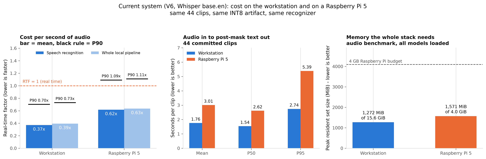
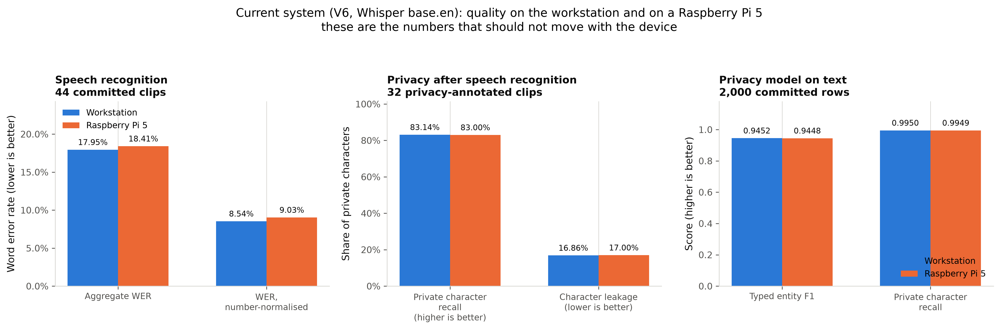
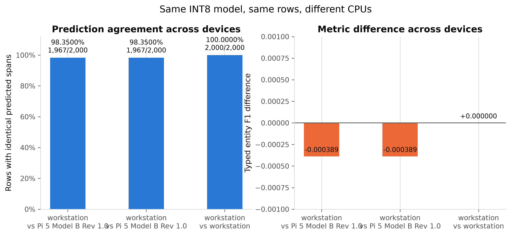
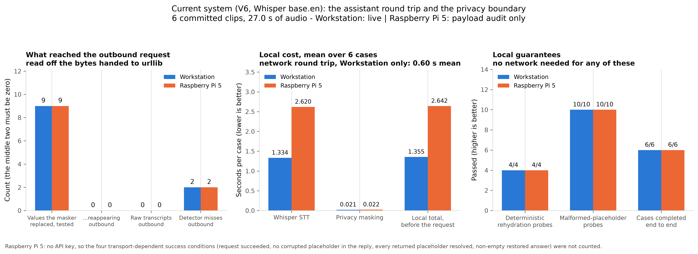

<p align="center">
  
</p>

<h1 align="center">OnKith</h1>

<p align="center">
  <strong>Privacy-preserving local voice processing for edge AI systems.</strong><br>
  <em>What happens at home, stays at home.</em>
</p>

<p align="center">
  <a href="https://onkith.online/">Website</a>
  &nbsp;·&nbsp;
  <a href="#raspberry-pi-5-deployment">Raspberry Pi results</a>
  &nbsp;·&nbsp;
  <a href="#how-onkith-evolved">How it evolved</a>
  &nbsp;·&nbsp;
  <a href="#reproducing-the-benchmarks">Reproduce</a>
  &nbsp;·&nbsp;
  <a href="#known-limitations">Limitations</a>
  &nbsp;·&nbsp;
  <a href="https://onkith.online/connect">Connect</a>
</p>

---

> **`FullPipeline_V6` is the current system, and it has been measured on both
> devices.**
>
> [`FullPipeline_V6/`](FullPipeline_V6/) is the one pipeline to run. Everything
> from the microphone to the post-mask transcript is **V4's code, byte for
> byte** — Silero VAD, the segmenter, **faster-whisper `base.en`** (CTranslate2,
> CPU, INT8, beam 5), transcript merging, DeBERTa-v3-xsmall INT8 masking, span
> merging, the spoken-form rewrite, spoken-digit rendering, storage and the
> terminal UI. On top of it sits the assistant layer built in V5: wake/intent
> routing, a **masked-text-only** LLM request, local reply rehydration, local
> TTS and a localhost UI.
>
> Six committed benchmark runs cover it — audio pipeline, CPU/text privacy and
> the assistant round trip, on a development workstation and on a **Raspberry
> Pi 5 (4 GB)**. They are in
> [`research_results/v6_benchmarks/`](research_results/v6_benchmarks/), and the
> canonical run id behind every number in this file is listed in
> [`research_results/README.md`](research_results/README.md). Nothing about V6's
> deployment behaviour is inferred from an earlier pipeline.
>
> Adding the assistant lane changed **nothing** in the local core: on the same
> device and the same fixtures, every V6 quality metric is identical to V4's to
> machine precision. Two tests enforce it — `tests/test_v6_independence.py`
> compares every inherited file against the archived V4, and
> `test_masking_parity.py` runs fixed text through V3, V4 and V6 in isolated
> interpreters demanding identical masking — and
> [`research_results/tables/current_system_inherits_previous_core.csv`](research_results/tables/current_system_inherits_previous_core.csv)
> is the measurement.
>
> **The written academic report evaluates V4.** That is a scoping decision about
> the report, not a gap in the evidence: V4's results stand, V6's local core is
> V4's, and V6 now has its own measurements on the same devices and the same
> fixtures. This README reports V6.
>
> V5 was the Parakeet experiment. On the same 44 clips Parakeet more than halved
> word error rate (0.0644 against 0.1795) and ran three times faster (STT RTF
> 0.114 against 0.371), but it leaked *more* private characters (0.2701 against
> 0.1686), needed ~575 MiB more peak RSS, and brought a ~2 GB torch/NeMo dependency
> tree with packages that have no aarch64 wheels. The assistant layer it produced
> was kept; the recognizer was not, and V5 was deliberately never taken to the
> Pi. V3's Canary pipeline and V4 are preserved alongside it in
> [`archive/`](archive/) — see [`archive/README.md`](archive/README.md). Their
> measurements in [`research_results/`](research_results/) are frozen baselines
> and are never regenerated; the comparison between generations is one of this
> repository's results.


OnKith is a voice pipeline that does its listening, transcription and privacy
filtering on a small edge device. Speech recognition and PII detection run
locally; only the **post-mask** text is available to anything downstream. Raw
audio and the raw transcript are not sent to the downstream language model — a
benchmark reads the bytes handed to the HTTP client and checks it, rather than
asserting it.

The whole system — speech recognition, privacy detection, masking, and the
assistant round trip — has been measured end to end on a **4 GB Raspberry
Pi 5**. The results, including the uncomfortable ones, are below.

## The problem

Voice assistants are useful because they understand natural speech. They are
uncomfortable because understanding natural speech has usually meant streaming
your living room to someone else's servers.

The usual privacy controls are all-or-nothing. You either send the whole
utterance to the cloud, or you send nothing and lose the capability. But most
sentences are not uniformly sensitive:

```text
"Remind me to call Dr. Sarah Chen at 555-0147 about my appointment on Tuesday."
```

The useful intent — *set a reminder about an appointment on Tuesday* — carries
almost no privacy risk. The name and the phone number carry nearly all of it.
Discarding the sentence throws away the intent; forwarding it exposes the
identifiers.

OnKith separates the two. Sensitive spans are detected and replaced locally, and
only the redacted remainder is available to anything downstream:

```text
"Remind me to call [TITLE_1] [GIVENNAME_1] [SURNAME_1] at [TELEPHONENUM_1]
 about my appointment on [DATE_1]."
```

## Why local processing matters

Redaction only helps if it happens *before* the data leaves your control. A cloud
service that promises to delete identifiers has already received them. OnKith
performs speech recognition and PII removal on the device, so:

- raw audio is not transmitted and is not written to disk;
- the unredacted transcript exists in process memory only, and is not stored;
- the placeholder map that could reverse the masking never leaves the device;
- the pipeline keeps working with no network connection at all;
- if masking fails for any reason, the text is **blocked rather than released**.

That last point is the design rule the rest of the system is built around: the
pipeline fails closed. A masking error never degrades into passing the original
text through.

Two things this does **not** claim, and the repository is careful about the
difference. It does not claim the detector finds every private value — it does
not, and [the measurements below](#raspberry-pi-5-deployment) say by how much.
It claims that values the detector *did* find were not reintroduced at the
tested outbound boundary, which is a separate property and is separately
measured.

---

## System architecture

```text
microphone (16 kHz mono)
   │
   ▼
Silero VAD + energy gate          400 ms pre-roll, endpoint detection,
   │                              overlap-based segmentation of long speech
   ▼
faster-whisper base.en            on-device speech-to-text, CTranslate2,
   │                              CPU, INT8, beam size 5
   ▼
transcript merge + normalisation  14-word overlap merge, wake-word handling,
   │                              3.0 s inactivity buffer
   ▼
spoken-address rewrite            "billing at example.org" -> the written form,
   │                              for the detectors only; spans projected back
   ▼
DeBERTa-v3-xsmall INT8            31 entity types / 63 BIO labels,
   │                              ONNX Runtime, 512-token window, 128 stride
   ▼
structured recognizers            regex layer for explicitly cued emails,
   │                              phone, account and identifier numbers
   ▼
whole-word span merge             deterministic overlap resolution
   │
   ▼
conversation-scoped placeholders  [GIVENNAME_1] = Fahad, kept in this process
   │                              and never sent anywhere
   ▼
post-mask text ──▶ local SQLite ──▶ terminal / localhost UI
   │
   │  only if a question clears the privacy gate
   ▼
downstream LLM (Groq)             receives placeholders, never their values
   │
   ▼
placeholder-preserving reply
   │
   ▼
local rehydration                 placeholders refilled from the local map
   │
   ▼
local TTS + screen
```

Everything above the `downstream LLM` line runs on the device, and that request
is the only thing that leaves it. Raw audio and the raw transcript are not sent
to it. The production package is [`FullPipeline_V6/`](FullPipeline_V6/).

| Version | What it is | Recognizer | Measured on | Status |
|---|---|---|---|---|
| V3 | Canary baseline | NVIDIA Canary 180M Flash | workstation + Pi 5 | archived, frozen results |
| V4 | The system the written academic report evaluates | faster-whisper `base.en` | workstation + Pi 5 | archived, frozen results, core reused by V6 |
| V5 | Parakeet + assistant experiment | NVIDIA Parakeet 110M TDT | workstation only, by decision | archived |
| **V6** | **Current system: V4 core + V5 assistant layer** | faster-whisper `base.en` | **workstation + Pi 5** | **maintained** |

Three details make the masked output trustworthy rather than merely plausible:

- **Whole-word consolidation.** Transformer models see subwords. Masking at the
  subword level produces leaks like `[EMAIL]@example[EMAIL]`, where the domain
  survives. OnKith promotes subword evidence to complete words before masking.
- **Sliding windows.** Text longer than the 512-token context is re-encoded as
  overlapping windows with 128-token stride, and every token is scored. Long
  input is never silently truncated.
- **Fail-closed release.** `safe_to_release` gates the output. A masking error
  blocks the utterance instead of publishing it.

---

## How OnKith evolved

OnKith did not start as the system above. Three tracks changed independently, and
each change was driven by a measurement that exposed a problem.

### 1. The privacy model

```text
binary sentence classifier → BiLSTM span baseline → TinyBERT-4 → DeBERTa-v3-xsmall → ONNX → INT8 → Pi
```

| Stage | What it was | Why it changed |
|---|---|---|
| Binary classifier | An LSTM that labelled a whole sentence private or not. | Too coarse. OnKith has to remove *the sensitive part* and keep the rest, which a sentence-level label cannot express. Replaced by span-level PII detection ([`model/baseline_model/`](model/baseline_model/)). |
| BiLSTM baseline | First span model. Token-level binary F1 **0.6051** on its own split. | Established the task and the harness. Not competitive, and not span-comparable to what followed. |
| TinyBERT-4 INT8 | 4-layer transformer, 67 BIO labels, 13.7 MiB INT8 ONNX. Deployed in the pipelines now under `archive/`. | Strong in-distribution (typed entity F1 **0.9502** on held-out validation) but the first out-of-distribution fixtures showed it collapsing — see below. |
| DeBERTa-v3-xsmall INT8 | Model V2: 31 entity types / 63 BIO labels, 78.5 MiB INT8 ONNX. Current production. | Chosen for out-of-distribution robustness, not headline F1. |

The evidence is in
[`model/privacy_evaluation/OOD_BASELINE_FINDINGS.md`](model/privacy_evaluation/OOD_BASELINE_FINDINGS.md),
which landed in the same commit as the first DeBERTa backbone preflight — the
measurement and the search for a replacement were one piece of work. On two
independently generated 360-case fixtures, TinyBERT scored typed entity F1
0.44–0.46 with private-character recall of **0.32–0.35**, and false-positive
rates on hard negatives near 0.65. Its stated conclusion shaped everything after
it:

> Strong IID scores do not predict robust OOD privacy behavior.

<p align="center">
  
</p>

### 2. The data

The dataset strategy changed more than the architecture did, and for the same
reason: evaluation kept exposing weaknesses.

| Stage | What changed | Why |
|---|---|---|
| Sentence labels | Binary private/non-private text. | Wrong shape for masking. |
| PII masking corpora | Moved to [AI4Privacy](https://huggingface.co/datasets/ai4privacy) with full BIO token labelling. `pii-masking-300k` for the BiLSTM baseline, then the larger `pii-masking-openpii-1.5m` (pinned revision) for Model V1 (TinyBERT-4) and as the Model V2 base. | Span-level supervision at real scale. |
| Ontology rebuild | 33 entities / 67 labels → **31 entities / 63 labels**. `ALLERGIES` (3 spans), `USERNAME` (16 spans) and `WEIGHT` (1 span) removed; `PASSWORD` added. | Labels with a handful of spans are not coverage. `PASSWORD` protects a *disclosed secret* under explicit admission rules, and the rejected cases ("I forgot my password") became hard negatives. |
| Supplementary sources | Gretel `gretel-pii-masking-en-v1`, DataikuNLP `kiji-pii-training-data`, NVIDIA `Nemotron-PII` (optional), plus a project-generated Saudi/MENA corpus. | Targeted gap-filling for empty and OOD-weak labels, not bulk volume. |
| Saudi / local coverage | A generated Saudi/MENA supplementary corpus built from public official sources — Saudi Central Bank licensed-institution names, government and university nomenclature, Wikidata city labels, an open traffic-intersection export, and a CC0 Arabic/Muslim given-name vocabulary. Saudi IBANs use the correct SAMA format and VAT numbers the 15-digit ZATCA format. | Upstream corpora are overwhelmingly Western. Saudi identifier formats, city and organisation names were simply absent. It is a deliberately small, curated addition (450 rows) rather than bulk synthetic volume. |
| Leakage-aware splitting | Supplementary data split 80/20 by connected components over four enforced factors: entity value, e-mail domain, template, organisation family. Three further factors are measured but deliberately not enforced. | A random split over generated data validates memorisation. Grouped splitting is what makes `val_supplementary` mean something. |
| Contamination firewall | A deterministic sweep removes training-side rows that are byte-identical to a protected evaluation row. Protected sets are never modified. | AI4Privacy ships zero-length `source_text` rows in *both* its official train and validation splits, so eight pinned training rows collided with `val_original`. |
| Frozen OOD final | A 360-case fixture in a separate notebook that refuses to run twice. | A benchmark inside a development notebook eventually gets run by accident, and then it is a selection metric rather than a test. |

Full methodology: [`model/privacy_data_v2/README.md`](model/privacy_data_v2/README.md).

The assembled corpus is published as
[`KhalidAlharbi377/pii-detection-multisource-en-saudi-arabic`](https://huggingface.co/datasets/KhalidAlharbi377/pii-detection-multisource-en-saudi-arabic)
(CC BY 4.0): 284,619 English rows, 2,088,335 labelled spans, 31 entity types, in
the same four splits this repository's data manifest records — 217,667 train,
40,909 original validation, 6,907 supplementary validation, 19,136 test. Its
composition is 85.0% AI4Privacy OpenPII, 8.3% NVIDIA Nemotron-PII, 3.6% Gretel,
2.2% Kiji, plus the OnKith-generated password disclosures (2,145 rows), Saudi/MENA
rows (450) and hard negatives (146).

That history is why OnKith reports six evaluation views instead of one number.
Each exists because a single score was once misleading:

| View | Rows | What it answers |
|---|---:|---|
| `test` | 19,136 | Held-out, same distribution as training. |
| `val_original` | 40,909 | The untouched AI4Privacy English validation split — the one metric comparable across model generations. |
| `val_supplementary` | 6,907 | Grouped 20% holdout of the supplementary pool. Harder, and honest about it. |
| `combined_validation` | 47,816 | Both validation sets together. |
| `ood_dev` | 360 | Speech-shaped, adversarial, independently generated. May guide error analysis. |
| `ood_final` | 360 | Same design, frozen, scored **once**. |

Two deployment benchmarks sit on top of those: a 2,000-row CPU/text subset that
verifies the *deployed artifact* behaves identically on two devices, and a
44-clip audio benchmark that measures the whole system from sound.

### 3. Speech-to-text

The recognizer changed repeatedly during real microphone testing, and the
repository records the configurations rather than a written head-to-head, so this
part is reported briefly and factually.

| Stage | Model | What the repository records |
|---|---|---|
| First Pi experiment | Moonshine | Audio captured manually so RNNoise denoising could be inserted ahead of the recognizer, using Moonshine's integrated VAD/segmenter ([`archive/moonshine_pi_project/`](archive/moonshine_pi_project/)). |
| Tuned STT harness | Moonshine v2 Medium Streaming | RNNoise ended up **off**; VAD threshold, pre-roll and endpoint silence tuned by hand. Word error rate recorded across six conditions: **8.73%** on `test-clean`, **12.10%** on direct live-microphone input, and 32.83% in a hard room ([`archive/moonshine-pi-v2/`](archive/moonshine-pi-v2/)). The harness targeted the Pi, but the table does not state which device each row was measured on. |
| Integrated pipelines V1/V2 | Moonshine v2 Medium Streaming | Speech recognition and TinyBERT masking in one process. |
| Pipeline V3 | **NVIDIA Canary 180M Flash** | Silero VAD replaces Moonshine's integrated segmentation; overlap segmentation plus a 14-word merger handles long speech. Committed reference: **4.90%** WER on LibriSpeech. |
| Pipeline V4 | **faster-whisper `base.en`** | Same architecture, different recognizer. Chosen on a measured Raspberry Pi result, not on a WER claim: see below. |
| Pipeline V6 *(current)* | **faster-whisper `base.en`** | V4's recognizer and privacy core unchanged, plus the assistant layer. Benchmarked on both devices in its own right. |

So: several recognizers were run against a real microphone before the project
converged on Canary. What is *measured in this repository* is that Moonshine's
live-microphone word error rate was around 12% while Canary's committed
LibriSpeech reference is 4.90%; those two numbers come from different scripts and
are not a controlled comparison, and the repository contains no written record of
the moment the decision was taken.

The Raspberry Pi benchmark then showed that the recognizer, not the privacy
model, is what limits the system — which is only interesting because the
recognizer had already been treated as the replaceable component. Canary needed
**2.02× real time** on the Pi 5. That is not a deployment; it is a batch job.

V4 replaced it with faster-whisper `base.en`, and V6 runs the same recognizer.
Every generation has now been measured on both devices through the same
benchmark. The honest summary is that the swap bought deployment feasibility and
cost transcription accuracy:

| On the Raspberry Pi 5 | V3 Canary 180M | **Current system (V6)** |
|---|---:|---:|
| Mean STT real-time factor | 2.022 | **0.617** |
| Mean full-pipeline RTF | 2.041 | **0.634** |
| Peak process RSS, audio benchmark | 2,031 MiB | **1,571 MiB** |
| Aggregate WER, engine-comparable | **0.0403** | 0.0903 |

The word error rates in that last row are number-normalised on both sides.
Canary wrote spoken numbers as words and Whisper writes numerals, so the raw
figures (0.0403 against 0.1841) are measuring orthography as much as
recognition; folding numbers to numerals on both sides is what makes the
comparison mean anything. Either way **Canary is the more accurate recognizer on
this corpus**, and the swap is not a claim to the contrary.

---

## Final privacy model

**DeBERTa-v3-xsmall, 31 entity types / 63 BIO labels, INT8 ONNX, 78.47 MiB.**
SHA-256 `bc8d1d7a7fb14304e195e47079c3dbb330c627ea4c9753f3af667676048106a8`,
verified by every benchmark before it reports a privacy number.

| View | Rows | Typed entity F1 | Private character recall | Leakage |
|---|---:|---:|---:|---:|
| `test` | 19,136 | 0.9527 | 0.9973 | 0.0027 |
| `val_original` | 40,909 | **0.9588** | 0.9983 | 0.0017 |
| `val_supplementary` | 6,907 | 0.8849 | 0.9843 | 0.0157 |
| `combined_validation` | 47,816 | 0.9534 | 0.9969 | 0.0031 |
| `ood_dev` | 360 | 0.6882 | 0.8725 | 0.1275 |
| `ood_final` *(frozen, spent once)* | 360 | **0.6244** | 0.8390 | 0.1610 |

The top four rows are in-distribution. The bottom two are not, and the gap is
real: OOD typed F1 is about a third lower than IID. That gap is reported here
rather than buried because it is the honest description of how the model behaves
on speech it was never trained on.

Quantization cost at most **0.0182** typed F1 (on `ood_dev`) against a release
gate of 0.02, and every view passed. On `ood_dev`, INT8 actually *improved*
character recall over FP32.

### Model V1 → Model V2

Same held-out AI4Privacy English validation split, same metric definitions, both
decoded through the production span-decoding rule:

| Metric | TinyBERT-4 INT8 (V1) | **DeBERTa-v3-xsmall INT8 (V2)** |
|---|---:|---:|
| Typed entity F1 | 0.9502 | **0.9588** |
| Private character leakage | 0.0029 | **0.0017** |
| Non-private overmasking | 0.0044 | **0.0029** |

<p align="center">
  
</p>

In-distribution the improvement is modest. Out of distribution — the same 360-case
fixtures, model-only in both cases — it is the whole point:

| Fixture | Metric | TinyBERT-4 INT8 | **DeBERTa INT8** |
|---|---|---:|---:|
| OOD dev | Typed entity F1 | 0.4406 | **0.6882** |
| OOD dev | Private character recall | 0.3500 | **0.8725** |
| OOD dev | Hard-negative FP rate | 0.6389 | **0.2222** |
| OOD final *(frozen)* | Typed entity F1 | 0.4649 | **0.6244** |
| OOD final *(frozen)* | Private character recall | 0.3209 | **0.8390** |
| OOD final *(frozen)* | Hard-negative FP rate | 0.6528 | **0.2361** |

Character recall going from 0.32 to 0.84 on the frozen set is the result that
justified the migration: under distribution shift, Model V1 was letting roughly
two thirds of private characters through.

---

## Raspberry Pi 5 deployment

Every number in this section is a **direct measurement of `FullPipeline_V6`**,
from a committed run folder named beside it. Nothing here is inherited from an
earlier pipeline.

**Tested environment.** Raspberry Pi 5 Model B Rev 1.0, 4 GB class (3.95 GiB
visible), 64-bit Raspberry Pi OS, Linux `6.18.39+rpt-rpi-2712` aarch64, glibc
2.41, 4 cores, Python 3.11.9, ONNX Runtime 1.29.0, faster-whisper 1.2.1 on
CTranslate2 (CPU, INT8, beam 5). The workstation is an x86-64 Intel machine,
14 physical / 20 logical cores, 15.65 GiB RAM, Windows 11, ONNX Runtime 1.27.0.
Both ran the identical privacy artifact, SHA-256 `bc8d1d7a...048106a8`, verified
by each benchmark before it reported a number.

<p align="center">
  
</p>

### Does it run faster than real time?

On average yes, and not on every clip. `RTF < 1` means the device finishes a
clip in less time than the clip lasts.

Audio benchmark, 44 committed clips, 279.7 s.
Runs `20260823T142306Z_windows-amd64_audio-v6-whisper_full_workstation` and
`20260823T204339Z_linux-aarch64_audio-v6-whisper_full`.

| Measurement | Workstation | **Raspberry Pi 5** | Pi / workstation |
|---|---:|---:|---:|
| Mean STT real-time factor | 0.371 | **0.617** | 1.67x |
| P90 STT real-time factor | 0.702 | **1.090** | 1.55x |
| Mean full-pipeline RTF | 0.394 | **0.634** | 1.61x |
| P90 full-pipeline RTF | 0.729 | **1.109** | 1.52x |
| P50 end-to-end latency | 1.54 s | **2.62 s** | 1.70x |
| P95 end-to-end latency | 2.74 s | **5.39 s** | 1.97x |
| Peak process RSS | 1,272 MiB | **1,571 MiB** of 3.95 GiB | 1.24x |

**The complete OnKith pipeline runs on a 4 GB Raspberry Pi 5 without running out
of memory, and processes speech faster than it arrives on average.** Resident
memory goes 57 MiB at baseline to 90 MiB with the VAD loaded, 837 MiB once
Whisper is loaded and 1,464 MiB with the privacy model on top; peak during the
run was 1,571 MiB, about 39% of the board's RAM.

The P90 above 1 deserves a straight answer, because the intuitive reading of it
is wrong. **7 of the 44 clips exceeded real time on the Pi, and every one of
them was shorter than 2.3 s.** Whisper decodes a fixed 30-second window whatever
the clip length, so the per-clip cost has a floor; divided by 1.8 seconds of
audio that floor is an RTF above 1, and divided by 15 seconds it is not. Every
clip of 3 s or more stayed under real time, the worst at 0.68x. On the
workstation no clip exceeded real time at all. The per-clip scatter is in
[`audio_duration_scaling.png`](research_results/figures/audio_duration_scaling.png).

The privacy model is not the bottleneck and was never close to being one. On the
Pi, DeBERTa INT8 masking averages 24.9 ms per clip against 2,913 ms for speech
recognition: **0.8% of processing time**, against 96.8% for the recognizer. Any
further end-to-end speed-up has to come from the recognizer.

<p align="center">
  
</p>

### Workstation against Pi: the numbers that should not move

Quality is a property of the artifact, not of the board. These are the same
fixtures through the same INT8 file on both devices.

<p align="center">
  
</p>

| Measurement | Benchmark | Workstation | **Raspberry Pi 5** | Difference |
|---|---|---:|---:|---:|
| Aggregate WER | audio, 44 clips | 0.1795 | **0.1841** | +0.0046 |
| Aggregate WER, number-normalised | audio, 44 clips | 0.0854 | **0.0903** | +0.0050 |
| Private character recall after STT | audio, 32 privacy clips | 0.8314 | **0.8300** | -0.0013 |
| Private character leakage after STT | audio, 32 privacy clips | 0.1686 | **0.1700** | +0.0013 |
| Clips fully sanitized | audio, 32 privacy clips | 16 of 25 | **16 of 25** | 0 |
| Hard-negative false-positive clips | audio, 32 privacy clips | 1 of 7 | **1 of 7** | 0 |
| Typed entity F1 | text, 2,000 rows | 0.9452 | **0.9448** | -0.00039 |
| Private character recall | text, 2,000 rows | 0.9950 | **0.9949** | -0.00005 |
| Private character leakage | text, 2,000 rows | 0.0050 | **0.0051** | +0.00005 |
| Non-private overmasking | text, 2,000 rows | 0.0155 | **0.0154** | -0.00005 |

Prediction agreement between the two devices is **98.35%** on the 2,000-row
benchmark (1,967 rows with identical predicted spans), and the released masked
text is byte-identical on 98.55%. On the 360-case `ood_dev` cross-check it is
96.67%. Byte-identical output is not the expectation: two CPUs running different
INT8 kernels legitimately disagree on borderline tokens. What the numbers show is
that the disagreement leaves the quality metrics unchanged to three decimal
places.

<p align="center">
  
</p>

### What the Pi actually costs

Text benchmark, 2,000 committed rows.
Runs `20260823T142451Z_windows-amd64_v6-whisper_full_workstation` and
`20260823T203840Z_linux-aarch64_v6-whisper_full`.

| Measurement | Workstation | **Raspberry Pi 5** |
|---|---:|---:|
| Mean masking latency | 46.6 ms | **91.6 ms** |
| P50 / P95 / P99 | 36.5 / 97.2 / 166.0 ms | **62.4 / 233.0 / 475.1 ms** |
| Throughput | 21.40 rows/s | **10.91 rows/s** |
| Peak process RSS | 1,671 MiB | **1,928 MiB** of 3.95 GiB |

The Pi is about **twice as slow** at masking and delivers about **half** the
throughput. That is the honest figure, and it changes nothing about deployment:
masking is under 1% of the audio pipeline's processing time on either device.

> An earlier revision of this README said the Pi was *not* slower than the
> workstation at this workload. That claim came from the V3-era runs, where a
> noisy workstation measurement (P99 722 ms) happened to match the Pi's. The
> current-generation runs are cleaner and say otherwise.

### Did adding the assistant change the local core?

No. On the same device and the same fixtures, every quality metric of the current
system is identical to the previous one's to machine precision - 14 comparisons
across both benchmarks and both devices, all zero. Cost differs, which is
expected: a different process with different imports, measured on a different
day. Evidence:
[`current_system_inherits_previous_core.csv`](research_results/tables/current_system_inherits_previous_core.csv).

### The assistant round trip, and the privacy boundary

`Full_Pipeline_V6_EndToEnd_Benchmark.py` drives 6 committed clips through the
whole system and reads the **bytes the LLM client hands to `urllib`**, not the
arguments a function was called with. Every payload is written to the run folder
verbatim.

| Check | Workstation (live LLM) | **Raspberry Pi 5 (payload audit)** |
|---|---:|---:|
| Outbound payloads captured | 6 | **6** |
| Values the masker replaced, tested | 9 | **9** |
| ...reappearing in a payload | **0** | **0** |
| Raw transcripts in a payload | **0** | **0** |
| Gold entities the detector missed, in a payload | 2 | **2** |
| Deterministic rehydration probes passed | 4 / 4 | **4 / 4** |
| Malformed-placeholder probes passed | 10 / 10 | **10 / 10** |
| Local device command: outbound requests built | 0 | **0** |
| Mean local pre-request latency | 1.355 s | **2.642 s** |

<p align="center">
  
</p>

Two counts that are easy to conflate and must not be added together:
**values the masker replaced that reappeared outbound** is a boundary failure and
is zero on both devices; **gold entities the detector never found** is a recall
miss by the privacy model, is 2 on both devices, and is why the 44-clip audio
benchmark exists. A pipeline can have a sound boundary and an imperfect
detector, and this run says which.

**Scope, stated plainly.** The Raspberry Pi round trip
(`20260823T204627Z_linux-aarch64_e2e-v6-whisper_full`) ran **without a
`GROQ_API_KEY`**. The real client built each request and the bytes were audited,
but nothing was sent. Everything local - recognition, masking, the placeholder
map, rehydration probes, the local-command route - was measured on both devices.
The live-only measurements (network round trip, whether a real model returns
intact placeholders, API success rate, spoken output) exist for the **workstation
only**: there, all 6 requests succeeded, both replies that used a placeholder
used only intact ones, and both were resolved locally.

### Recognition and end-to-end privacy on the Pi

44 clips, 279.7 s of audio: 12 LibriSpeech dev-clean clips (recognition
reference) and 32 synthetic privacy clips with gold annotations. Real Silero
VAD, a real recognizer, the real production INT8 masker. No mocks.

<p align="center">
  
</p>

The deployment-feasibility comparison against the Canary generation, on the same
44 clips and the same board:

| On the Raspberry Pi 5 | V3 Canary 180M | **Current system (V6)** |
|---|---:|---:|
| Mean STT real-time factor | 2.022 | **0.617** |
| Mean full-pipeline RTF | 2.041 | **0.634** |
| Peak process RSS, audio benchmark | 2,031 MiB | **1,571 MiB** |
| Aggregate WER, engine-comparable | **0.0403** | 0.0903 |

Canary needed **2.02x real time** on the Pi 5. That is not a deployment; it is a
batch job. The swap to Whisper bought deployment feasibility and cost
transcription accuracy - the next section is the cost.

### Recognition accuracy: the part that got worse

| Word error rate, 44 clips, Raspberry Pi 5 | V3 Canary | **Current system** |
|---|---:|---:|
| Aggregate, as each run recorded it | 0.0403 | 0.1841 |
| Aggregate, number-normalised (engine-comparable) | **0.0403** | 0.0903 |
| Long numbers transcribed digit for digit | 5/5 | 3/5 |

The raw figures are not comparable between the two engines and the second row is
the one to read. Canary ran with `pnc: no` and wrote spoken numbers as words,
which is how the reference transcripts are written; Whisper writes numerals, and
the standard metric charges eight substitutions for correctly transcribing "five
five five, zero one eight eight" as `55550188`. Folding numbers to numerals on
both sides removes that and leaves the real gap: **Whisper is roughly twice as
error-prone as Canary on this corpus**, and it loses two of the five
identifier-scale numbers digit for digit.

That is a real cost, it is paid on the clips that matter most, and no amount of
downstream processing recovers it. `Tomas` transcribed as `To Mars` and `Okonjo`
as `Dr. Akanja` are gone before the privacy model ever sees them.

### End-to-end privacy, after imperfect speech recognition

Scored on the 32 privacy-annotated clips. All four arms are scored by one
implementation and one definition
(`model/privacy_evaluation/privacy_eval/rescore.py`), which is what makes the
columns comparable; see [the note on scoring](#the-stt-to-privacy-interface).

| Of 60 annotated entities | V3 Canary, Pi 5 | **Current system, Pi 5** |
|---|---:|---:|
| Survived speech recognition | 51 (85%) | 40 (67%) |
| **Reached no released text (protected)** | **47 (78%)** | **48 (80%)** |
| Masked in the form they were spoken | 41 | 33 |
| Private character recall | 0.8043 | **0.8300** |
| Private character leakage | 0.1957 | **0.1700** |
| Clips fully sanitized | 14 of 25 | **16 of 25** |
| Clips releasing no legible identifier | 3 of 5 | **5 of 5** |
| Hard-negative false-positive clips | 1 of 7 | 1 of 7 |

Both columns are Raspberry Pi runs: the current system from
`20260823T204339Z_linux-aarch64_audio-v6-whisper_full`, and the frozen Canary
baseline from `20260818T081310Z_linux-aarch64_audio_full`, rescored on the same
definition. The workstation run of the current system reaches 0.8314 character
recall and the same 16 of 25 fully sanitized clips, so the device makes no
difference here. The two recognizers reach **the same end-to-end privacy outcome
within the resolution of a 60-entity corpus**, by different routes: Canary
preserves more entities and the model masks more of them as spoken, while
Whisper destroys more entities outright but writes the ones it keeps in forms the
model handles at least as well.

This is not "Whisper improves privacy". A corpus of 60 entities cannot resolve a
one-entity difference, and the two arms differ in what they get wrong, not in how
much. What it does say is that the deployment gain did **not** cost end-to-end
privacy, which is the question the swap had to answer.

The one row that is a clean win is the last measurable one, and it is also the
only row that depends on no alignment at all: on the five clips whose reference
carries an identifier-scale number, the current system released **none** of them
in legible form and V3 released two. The mechanism is not better masking — it is that Canary's
digit-word spellings evaded the structured recognizer and were then reassembled
into numerals by the display renderer, which Whisper's numerals do not do.
See [`FullPipeline_V6/KNOWN_ISSUES.md`](FullPipeline_V6/KNOWN_ISSUES.md); the
renderer is unchanged and the behaviour is suppressed by orthography, not fixed.

Attribution of the 12 entities the current system still leaks: **5** where the
recognizer destroyed the entity and nothing was masked where it went, and **7**
privacy-model failures — of which three are numeral dates (`12th of March`,
`30th of September`, `4th of June`) that the model masks when they are spelled
out, and two are DATE/TIME misses that occur under both recognizers. The
recognizer altered a further 15 entities that were masked anyway.

These numbers are lower than the 2,000-row text benchmark, and they are supposed
to be: this is recognizer output, mis-segmented and misheard, and it is the input
that matters in deployment rather than the one that flatters the model.

---

## The STT-to-privacy interface

The privacy model was trained on written text. A recognizer does not produce
written text, and the seam between the two turned out to be the largest single
source of end-to-end error once Whisper replaced Canary — larger than the model,
and larger than the recognizer's own mistakes. Two distinct problems live there, and they need
keeping apart because only one of them is a defect in the pipeline.

### 1. A measurement defect, now fixed

The audio benchmark follows each annotated entity from the reference transcript
into the recognized one by aligning words, then measures what share of that
region the masker covered. Two details of that alignment were wrong in ways that
could only ever show up under Whisper:

- **Number spelling.** The reference says "twenty seven" and Whisper writes
  `27`. No token matched, so an entity that came through the recognizer
  *perfectly* was booked as destroyed by it, and the region measured for
  coverage excluded the very numeral it had become.
- **Sentence punctuation.** The located region was a whitespace-delimited run,
  so the region for `Carter` in "My name is Alex Carter." was `Carter.` — and a
  masker that correctly produced `[SURNAME_1].` scored six characters out of
  seven, a partial failure.

Canary emitted neither numerals nor punctuation, so V3's figures were untouched
by both, and the defect is why an uncorrected Whisper-era figure should not be
quoted. The effect was to **overstate Whisper's privacy failures by roughly a
factor of two**: the same run folder that reported 16 of 60 entities masked and
4 of 25 clips clean reports 33 and 14 once the alignment is corrected.

The fix is in `locate_entity`: fold spoken numbers to numerals on both sides
before aligning, and trim a located region to its alphanumeric core.
`privacy_eval/rescore.py` applies the corrected definition to any completed run
folder — including the frozen Canary ones, whose predicted spans turn out to be
exactly recoverable from the input/output text pair every run saved — so no
comparison in this repository is one definition against another.

### 2. A real interface gap, now narrowed

Whisper writes a dictated address the way it was spoken:

```
spoken     : billing at example dot org
recognized : billing at example.org
masked     : billing at [URL_1]        <- the local part is released
```

That is neither the spoken form nor the written form. The structured EMAIL
recognizer requires an `@`, the model has never seen an address written that
way, and the result was the domain masked and the mailbox name released in the
clear. It affected three of the three annotated EMAIL entities, and the same
shape with "slash" affected the one annotated URL.

`FullPipeline_V6/integrated_pipeline/spoken_form_normalizer.py` rewrites two
shapes — `<token> at <domain>` and `<domain> slash <path>` — into their written
form **for the detectors only**. Every span found on the rewritten view is
projected back onto the original text before anything is masked, so the released
transcript and everything stored is still exactly what the recognizer produced.
A span landing inside a rewritten region widens to cover the whole of it, so the
projection can only ever mask more, never less.

It is deliberately two rules and not a rule engine. Across every text this
repository holds — the audio corpus, `ood_dev`, `ood_final` and the 2,000-row
deployment benchmark, 3,072 in total — they fire on four regions, and all four
are the forms they exist for. The 2,000-row benchmark and the `ood_dev`
cross-check score **identically** with the stage and without it (typed F1 0.9452,
`ood_dev` 0.6882), and the audio benchmark's hard-negative false-positive count
does not move.

### What preprocessing cannot fix

Where the recognizer destroyed the entity, no stage downstream recovers it.
`Tomas` heard as `To Mars`, `Okonjo` as `Dr. Akanja`, `Leeds` as `leads`: the
information is gone before the privacy model runs, and a normalizer that "fixed"
those would be inventing content. Five of the twelve remaining leaks are of this
kind and are counted separately from model failures for exactly that reason.

Equally, `12th of March` is ordinary written English. When the model misses it —
and it does, on three clips where it masks the spelled-out form — that is a
model false negative, not an interface problem, and the fix belongs in the next
training generation rather than in a rewrite rule. The behaviour is identical on
both devices. Both distinctions are kept
explicit in
[`FullPipeline_V6/KNOWN_ISSUES.md`](FullPipeline_V6/KNOWN_ISSUES.md).

---

## Reproducing the benchmarks

Three entry points at the repository root produce every number above. None of
them trains a model, re-exports ONNX, or touches the frozen OOD holdout.

```bash
python Full_Pipeline_CPU_Benchmark.py           # 2,000-row text benchmark, ~3 min x86 / ~6 min Pi
python Full_Pipeline_Audio_Benchmark.py         # 44 clips end to end, ~1 min x86 / ~11 min Pi
python Full_Pipeline_V6_EndToEnd_Benchmark.py   # 6 live clips through the LLM round trip
```

All three accept `--smoke-test` for a fast check and `--help` for every option.
They are plain scripts, not notebooks, because the Raspberry Pi has no Jupyter
and one implementation that runs everywhere beats two that can drift. Each writes
a machine-readable folder plus a `benchmark_summary.md` you can read directly.

All three measure the pipeline named by
`privacy_eval.benchmark_common.PRODUCTION_ROOT`, which is `FullPipeline_V6`, and
write to `research_results/v6_benchmarks/<run_id>/` - deliberately apart from the
frozen V3/V4/V5 folders in `research_results/cpu_benchmarks/`, which are never
regenerated. Moving that one line is what retargets them; everything else about
the methodology is unchanged, which is what keeps runs comparable across
generations.

They need the production recognizer, which is not in the default install:

```bash
pip install --requirement FullPipeline_V6/requirements-rpi.txt      # or -windows.txt
```

That brings `faster-whisper` on CTranslate2 - no torch, and wheels for both
Windows and Raspberry Pi OS (aarch64). The `base.en` weights are fetched once on
first use and cached under `~/.cache/huggingface`; after that the device runs
offline. Without the recognizer the audio benchmark still verifies the fixtures,
runs the VAD and both reference-text control arms, records the memory profile,
reports exactly what is missing, and exits with code 2. It never fabricates a
transcript.

The end-to-end benchmark additionally needs `GROQ_API_KEY` for its live leg.
Without one it still runs everything local, still builds and audits the outbound
payload, and reports the API sections as `not run` with exit code 2 — see
[`FullPipeline_V6/README.md`](FullPipeline_V6/README.md).

Then regenerate the figures on any machine with the repository:

```bash
python -m jupyter nbconvert --to notebook --execute Research_Paper_Figures.ipynb \
  --output-dir /tmp --output figures_run.ipynb
```

[`Research_Paper_Figures.ipynb`](Research_Paper_Figures.ipynb) catalogues every
run folder under `research_results/v6_benchmarks/` and
`research_results/cpu_benchmarks/`, and draws each figure from the run named in
its `CANONICAL_RUNS` table - never from "the latest run". It writes
`research_results/{figures,tables,summaries}/`, and
`summaries/figure_index.json` records the exact run ids behind every figure. A
new run folder is reported as discovered-but-not-canonical until it is added to
that table, so nothing is picked up silently. Details:
[`research_results/README.md`](research_results/README.md).

### Tests

```bash
python -m pytest model/privacy_evaluation/tests -q     # evaluation harness, fixtures, metrics
cd FullPipeline_V6 && python -m pytest -q              # production pipeline
```

`model/privacy_evaluation/tests/test_masking_parity.py` runs fixed text through
V3, V4 and V6 in separate interpreters and requires identical masked output,
spans and rendered text, and
`FullPipeline_V6/tests/test_v6_independence.py` compares every inherited core
file against the archived V4. Together they keep "V6's local core is V4's" a
checked statement rather than a claim.

---

## Running the production pipeline

Quick start below; the full instructions are
[`FullPipeline_V6/README.md`](FullPipeline_V6/README.md).

### Windows (development and testing — WSL not required)

```powershell
cd FullPipeline_V6
py -3.11 -m venv .venv
.\.venv\Scripts\Activate.ps1
python -m pip install --upgrade pip wheel setuptools
python -m pip install -r requirements-windows.txt

python -m app.omit_ai_live --print-config
python -m app.omit_ai_live --text-test "My name is Rayyan Khan and my email is rayyan@example.com"
python -m app.omit_ai_live --list-devices
python -m app.omit_ai_live --device 2
```

`--text-test` exercises the whole privacy path without a microphone: it loads the
INT8 ONNX, masks the text, and prints the post-mask transcript.

Useful flags on either platform, verified against `--help`:

| Flag | Effect |
|---|---|
| `--headless` | keeps the assistant and local TTS, opens no browser window |
| `--no-assistant` | disables the LLM/TTS/UI add-on; runs the local core only |
| `--assistant-port N` | localhost port for the assistant UI (default 8765) |
| `--once` | process one utterance and exit |
| `--self-test` | start-up checks with no microphone |

The assistant needs a `GROQ_API_KEY` in a repository-root `.env`; copy
[`FullPipeline_V6/.env.example`](FullPipeline_V6/.env.example) and edit it. Both
`.env` locations are git-ignored. Without a key everything local still runs and
a question shows the masked text that *would* have been sent, with no network
request made.

### Raspberry Pi OS (64-bit)

```bash
cd FullPipeline_V6
chmod +x install_pi.sh run_live.sh check_pi.sh
./install_pi.sh          # installs the pinned runtime

./check_pi.sh            # hardware and artifact checks
./run_live.sh --list-devices
./run_live.sh --device 2
```

The Whisper `base.en` weights are fetched once by CTranslate2 on first use and
cached under `~/.cache/huggingface`; they are deliberately not stored in Git. The
DeBERTa INT8 model and the Silero VAD **are** committed, because they are this
project's own release artifacts and the Pi cannot rebuild them. `install_pi.sh`
also installs `espeak-ng`, so local speech works with no extra model. V3 instead
pinned a 700 MB `.nemo` file by SHA-256 and fetched it with
`archive/FullPipeline_V3/scripts/acquire_canary.py`; running that package again
would need the NeMo stack reinstalled.

The tested Pi environment is recorded under
[Raspberry Pi 5 deployment](#raspberry-pi-5-deployment), and every value there
comes from the run manifests rather than from memory.

---

## Repository structure

```text
OnKith/
├── FullPipeline_V6/          The current pipeline — V4 core + V5 assistant layer
│   ├── app/                  Entry point, audio runtime, live preview, terminal UI,
│   │                         plus assistant, llm, rehydrate, speech, light,
│   │                         assistant_surface, post_mask_assistant
│   ├── integrated_pipeline/  VAD, Whisper adapter, spoken-form rewrite, masking,
│   │                         span merge, storage, config — all V4's, unchanged
│   ├── models/               DeBERTa INT8 + tokenizer, Silero VAD, Piper voice config
│   ├── scripts/              Pi checks, release packaging, model download
│   ├── tests/                Production regression suite, assistant suite,
│   │                         V4-parity and independence gates
│   └── .env.example          Documents the root .env; secret-free
├── model/                    Research: training, data preparation, evaluation
│   ├── baseline_model/       BiLSTM span baseline and the binary classifier before it
│   ├── TinyBERT-4/           Model V1 — superseded, kept for provenance
│   ├── DeBERTa-v3-xsmall/    Model V2 — the deployed privacy model
│   ├── privacy_data_v2/      Ontology, sources, dedup, grouped splits, augmentation
│   ├── privacy_evaluation/   Metrics, OOD fixtures, benchmark runners, tests
│   └── data/                 Source-corpus builders (outputs stay local)
├── research_results/         Benchmark runs, figures, tables, summaries
│   ├── v6_benchmarks/        The current system: 6 runs, both devices
│   ├── cpu_benchmarks/       Frozen V3/V4/V5 runs, never regenerated
│   ├── figures/              PNG + PDF, regenerated by the notebook
│   ├── tables/               The numbers behind each figure, as CSV
│   └── summaries/            Figure index with run provenance, written overview
├── archive/                  Superseded pipelines and STT experiments
│   ├── FullPipeline_V3/      Frozen Canary baseline and implementation
│   ├── FullPipeline_V4/      The system the written report evaluates; V6's core
│   └── FullPipeline_V5/      Parakeet + assistant experiment; no Pi evaluation
├── Full_Pipeline_CPU_Benchmark.py
├── Full_Pipeline_Audio_Benchmark.py
├── Full_Pipeline_V6_EndToEnd_Benchmark.py
└── Research_Paper_Figures.ipynb
```

`FullPipeline_V6/` is a self-contained deployment package and the only
maintained one; it imports nothing from `archive/`, which a test enforces. The
V4 and V5 implementations are frozen at
[`archive/FullPipeline_V4/`](archive/FullPipeline_V4/) and
[`archive/FullPipeline_V5/`](archive/FullPipeline_V5/), and the V3
Canary implementation at
[`archive/FullPipeline_V3/`](archive/FullPipeline_V3/); their saved measurements
remain live comparison evidence even though the implementation is historical.
Everything in [`archive/`](archive/) is unmaintained and kept to show how the
design evolved; see [`archive/README.md`](archive/README.md).

---

## Evaluation methodology

The distinction between these four things matters, and the repository keeps them
separate everywhere:

1. **Large held-out text evaluation** is the primary model-quality evidence:
   47,816 validation rows plus a 19,136-row test split.
2. **Out-of-distribution fixtures** (360 dev, 360 frozen final) measure behaviour
   on speech-shaped input the model was not trained on. The final fixture is
   scored once, by a notebook that refuses to run twice.
3. **The 2,000-row CPU benchmark** is a *deployment parity* check, not a quality
   claim. It exists so that a workstation run and a Raspberry Pi run are
   comparable measurements of one hash-verified artifact.
4. **The 44-clip audio benchmark** is a *controlled deployment benchmark*, not a
   speech-recognition benchmark. Public LibriSpeech clips carry no gold privacy
   annotation and are used only for word error rate, latency and memory; the
   synthetic privacy clips carry the annotations and are used only for privacy
   metrics. Read prose is full of person names that would otherwise charge the
   model for correct detections.
5. **The 6-clip round-trip benchmark** is an *integration and boundary* check,
   not a third accuracy benchmark. It answers one question the other two
   structurally cannot: of the values the masker replaced, did any reach the
   bytes handed to the outbound HTTP client? It is deliberately small, and its
   accuracy columns are not a substitute for the 44-clip run.

Every private value in the synthetic clips is fictional: RFC 2606 reserved
`example` domains, the NANP 555-01xx range reserved for fiction, and invented
names, addresses and document numbers.

---

## Known limitations

- **Real-time on the Pi 5 has little headroom, and short utterances are the
  problem.** Mean STT RTF is 0.617 on the tested board, which is what makes live
  use possible at all — V3's Canary was 2.02 and could not keep up. But the P90
  full-pipeline RTF is 1.109: 7 of the 44 benchmark clips exceeded real time, and
  every one of them was shorter than 2.3 s. Whisper decodes a fixed window
  whatever the clip length, so a short utterance pays a fixed cost. Every clip of
  3 s or more stayed under real time, the worst at 0.68×. Turn-based interaction
  is comfortable; continuous streaming under load is not characterised.
- **The Raspberry Pi is about twice as slow at masking as the workstation.** Mean
  masking latency is 91.6 ms against 46.6 ms, and throughput is 10.91 rows/s
  against 21.40. It does not affect deployment — masking is under 1% of the audio
  pipeline's processing time — but the earlier claim that the two devices were
  equal at this workload came from noisier V3-era runs and does not hold.
- **The recognizer swap cost transcription accuracy.** Number-normalised
  aggregate WER goes from 0.0403 under Canary to 0.0903 under Whisper on the
  44-clip corpus, and two of five identifier-scale numbers are no longer
  transcribed digit for digit. The deployment gain is real and this is what paid
  for it.
- **Speech recognition errors are the largest irreducible privacy failure.** Of
  the 12 annotated entities the current system still leaks, 5 were destroyed by
  the recognizer before the privacy model saw them. No preprocessing recovers a
  name that was never transcribed.
- **The out-of-distribution gap is material.** Frozen `ood_final` typed F1 is
  0.6244 against 0.9588 on in-distribution validation, and character leakage
  rises from 0.0017 to 0.1610. The model is much weaker on speech-shaped input it
  has not seen.
- **Numeral dates and times are missed where the spelled-out forms are masked.**
  `12th of March` and `30th of September` pass through unmasked; the same clips
  under Canary, which spelled them out, were masked. This is a model false
  negative on ordinary written English, not an interface problem, and the fix is
  training data rather than a rewrite rule. Three of the twelve remaining leaks.
- **The spoken-address rewrite can absorb the word before " at ".** Nothing
  distinguishes an email local part from an ordinary word by shape, so
  `Look at example.com` becomes `Look@example.com` and `Look` is masked with the
  domain. It can only ever mask more of a sentence that already contains a domain
  the model would have masked anyway, it fires on no such case in any corpus this
  repository holds, and the hard-negative and text-benchmark scores do not move —
  but it is a real, accepted overmask.
- **Spoken-form numeric identifiers can evade masking, and the display layer can
  reassemble them.** Under V3, numbers arrived as digit words and the render-time
  digit normaliser rewrote any that survived masking as `5550147` — 2 of 60
  entities, reproduced identically on the workstation and the Pi. The current
  system records zero of these on both devices, and that is not a fix: Whisper
  writes numerals itself, so a surviving
  identifier is already compact in the released text rather than being assembled
  downstream. The renderer is unchanged and would do the same to any digit-word
  run reaching it. Storage and downstream processing keep the original text; the
  reconstruction reaches the terminal display only.
- **Structured recognition is cue-dependent.** The regex layer fires on explicit
  cues ("my phone number is", "call me at"). An identifier introduced differently
  falls back to the model alone. The cue-less floor is nine digits, so 7- and
  8-digit identifiers with no recognised cue are unprotected by that layer.
- **The 44-clip audio suite is deployment evidence, not a speech benchmark.** It
  is small, half of it is synthetic, and it does not characterise real-world
  conversational speech.
- **PII, not contextual privacy.** The model detects identifiable entities. A
  medical worry or a family conflict containing no identifiers passes through.
- **Recognition errors propagate.** A misheard name may not be detected as a
  name. Masking quality is bounded by transcription quality.
- **Repeated mentions get different placeholder numbers.** One person named twice
  becomes `[GIVENNAME_1]` and `[GIVENNAME_2]`. Nothing leaks, but the stored
  transcript reads as two people. Documented in
  [`FullPipeline_V6/KNOWN_ISSUES.md`](FullPipeline_V6/KNOWN_ISSUES.md).
- **The privacy boundary is verified, the detector is not perfect, and the two
  are different claims.** In the round-trip benchmark, no value the masker
  replaced reappeared in the outbound payload and no raw transcript did, on
  either device. In the same run, 2 gold entities the detector never found did go
  out. The first is the boundary working; the second is a recall miss, and it is
  the number the 44-clip audio benchmark exists to measure.
- **The Raspberry Pi round trip was measured without an API key.** Its outbound
  payloads were built by the real client and audited, but no request was sent, so
  network latency, placeholder preservation by a real model, API success rate and
  spoken output on the Pi are **not measured**. Those exist for the workstation
  only.
- **English only, 64-bit ARM only, single speaker assumed.** No diarisation.

## Future work

- Recover the recognition accuracy the Whisper swap traded away — a larger
  Whisper variant or a distilled model that keeps RTF < 1 on a Pi 5 — and
  re-measure both halves.
- Reduce the fixed per-clip decode cost that puts short utterances over real time
  on the Pi, which is a decoder-configuration question rather than a model one.
- Numeral date and time forms in the next training generation, which is where
  three of the remaining leaks are.
- Re-screening the text after every post-masking transformation, so a render-time
  step can never reassemble something the privacy layer declined to protect.
- Run the assistant round-trip benchmark on the Raspberry Pi **with** an API key,
  so the network leg, placeholder preservation and spoken output are measured
  there rather than only on the workstation.
- A broader natural-speech privacy dataset — the current audio privacy set is
  synthetic by necessity.
- Further OOD robustness work: `ood_final` is spent, so the next generation needs
  a newly built frozen fixture.
- A larger real-device audio evaluation across more speakers, rooms and
  microphones.

---

## Models, datasets and licences

**Models**

| Component | Model | Licence |
|---|---|---|
| Speech-to-text | [`Systran/faster-whisper-base.en`](https://huggingface.co/Systran/faster-whisper-base.en), a CTranslate2 conversion of [`openai/whisper-base.en`](https://huggingface.co/openai/whisper-base.en) | MIT |
| Previous speech-to-text | [`nvidia/canary-180m-flash`](https://huggingface.co/nvidia/canary-180m-flash) | CC BY 4.0 |
| Privacy detection | Fine-tuned from [`microsoft/deberta-v3-xsmall`](https://huggingface.co/microsoft/deberta-v3-xsmall) | MIT |
| Previous privacy model | Fine-tuned from [TinyBERT](https://huggingface.co/huawei-noah/TinyBERT_General_4L_312D) | Apache 2.0 |
| Voice activity detection | [Silero VAD](https://github.com/snakers4/silero-vad) | MIT |
| Earlier speech-to-text | [Moonshine](https://github.com/moonshine-ai/moonshine) | see upstream |
| Inference runtime | [ONNX Runtime](https://onnxruntime.ai/) | MIT |
| Speech inference runtime | [CTranslate2](https://github.com/OpenNMT/CTranslate2) via [faster-whisper](https://github.com/SYSTRAN/faster-whisper) | MIT |

**Datasets**

| Dataset | Role | Licence |
|---|---|---|
| [`ai4privacy/pii-masking-openpii-1.5m`](https://huggingface.co/datasets/ai4privacy/pii-masking-openpii-1.5m) | Model V2 base corpus, pinned revision | CC BY 4.0 |
| [`ai4privacy/pii-masking-300k`](https://huggingface.co/datasets/ai4privacy/pii-masking-300k) | BiLSTM baseline corpus | Custom AI4Privacy licence — academic use with citation; commercial use requires contacting AI4Privacy |
| [`gretelai/gretel-pii-masking-en-v1`](https://huggingface.co/datasets/gretelai/gretel-pii-masking-en-v1) | Supplementary | Apache 2.0 |
| [`DataikuNLP/kiji-pii-training-data`](https://huggingface.co/datasets/DataikuNLP/kiji-pii-training-data) | Supplementary | Apache 2.0 |
| [`nvidia/Nemotron-PII`](https://huggingface.co/datasets/nvidia/Nemotron-PII) | Supplementary, optional | CC BY 4.0 |
| [`KhalidAlharbi377/pii-detection-multisource-en-saudi-arabic`](https://huggingface.co/datasets/KhalidAlharbi377/pii-detection-multisource-en-saudi-arabic) | The assembled Model V2 corpus, published | CC BY 4.0 |
| [LibriSpeech](https://www.openslr.org/12) dev-clean subset | Audio benchmark recognition reference | CC BY 4.0 |
| [Piper TTS](https://github.com/rhasspy/piper) (LJ Speech, LibriTTS-R, VCTK voices) | Synthetic privacy speech clips | MIT / CC BY 4.0 / public domain |

The Saudi/MENA supplementary corpus is generated by
[`model/data/saudi_PII_Builder.ipynb`](model/data/saudi_PII_Builder.ipynb) from
public official sources; every source, its status and its licence are recorded in
[`model/data/saudi_mena_pii_manifest.json`](model/data/saudi_mena_pii_manifest.json).
Generated corpora stay local — the manifest carries the hashes and seeds needed
to rebuild them identically.

---

## Team

Built by **Yahya Alsharif**, **Faris Alshehri**, **Turki Alshuaibi**,
**Abdullah Alhulays**, **Khalid Alharbi** and **Sami Al Irhain**.

Developed as a team project under **KAUST Academy**.

## Links

- Project website — <https://onkith.online/>
- Connect with the team — <https://onkith.online/connect>
- Repository — <https://github.com/YahyaAlsharif/OnKith>
- Dataset — <https://huggingface.co/datasets/KhalidAlharbi377/pii-detection-multisource-en-saudi-arabic>
